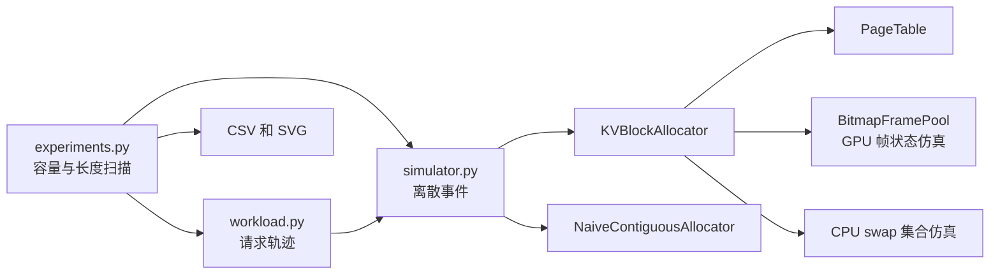
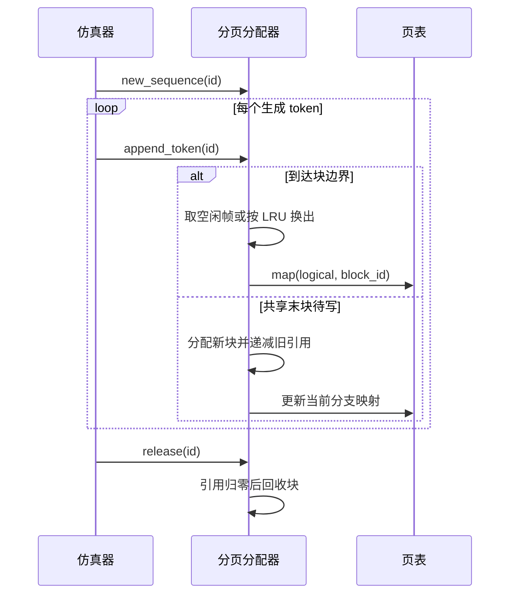

# 任务一：KV Cache 分页内存管理子系统设计

## 范围与目标

本项目以操作系统分页机制建模推理期间的 KV Cache 块管理。CPU 仿真层研究分配、地址翻译、共享、写时复制、换出与 OOM 边界；真实 GPU 验证需要独立记录模型、硬件及推理引擎配置。当前 CPU 层仅处理块元数据，不处理真实 Key/Value 张量，也不执行注意力计算。

## OS 概念映射

| OS 概念 | 本系统对象 | 不变量 |
|---|---|---|
| 页帧 | GPU block frame | 每个驻留块独占一个帧 |
| 虚拟页 | 序列的逻辑 token 块 | 每 16 个 token 一块 |
| 页表 | `PageTable.entries` | 逻辑块号映射稳定 block id |
| 按需分页 | `append_token` | 新块仅在跨越块边界时分配 |
| 地址转换 | `translate` | 返回 GPU frame 与块内偏移 |
| COW | `fork`、`share_prefix` | 共享块引用计数归零后才回收 |
| 页面置换 | `_frame`、`evict` | LRU 受害块转入模拟 CPU 块集合 |
| 缺页 | `_resident` | 访问换出块时取得 GPU 帧并计数 |
| 连续分配 | `NaiveContiguousAllocator` | 从空闲连续区间预留最大长度 |

## 块池与页表取舍

用户确认按合并版第 2 周要求补显式位图。`BitmapFramePool` 用每帧一位的位图记录空闲/占用，并用空闲帧栈提供 O(1) 取帧与回收；位图在每次取还时同步更新，发现重复回收或越界帧会报错。该实现管理的是固定大小的 KV 页框，因此不需要用伙伴系统拆分可变大小块。LRU 受害块选择仍需扫描驻留块，不属于空闲栈取还的 O(1) 保证范围。

页表保留单层稀疏字典。合并版第 3 周的验收项是页表与逻辑到物理映射；多级页表出现在 OS 概念映射章节。当前实验最大上下文 4096 token、块大小 16，每序列最多 256 个逻辑块；字典只保存已映射条目，已实现按需稀疏建表。用户确认本任务不额外实作两级页表，避免为了小规模地址空间增加第二层索引；此选择不改变 `translate` 的结果或 COW/换出语义。

## 模块图

## 序列状态与关键时序

`Block` 的稳定 ID 与 GPU 帧号分开。被换出后稳定 ID 不变，帧号为空；访问时触发模拟换入。`fork` 共享现有块并增加引用；在部分填满的共享末块继续写入时，新分支取得新块。CPU swap 容量不足时抛出 `AllocError`。

## 仿真路径与边界

- `naive`：到达时按 `M` 预留连续区间；释放时合并相邻空闲区间。
- `paged`：到达时按已知最终 `L` 一次性分配，用作旧实验对照，不代表真实逐 token 生成。
- `paged_dynamic`：到达后在请求持续时间内均匀产生 token，跨块边界扩页；此实验 CPU swap 容量设为零，以便观察 GPU 容量 OOM。若扩页失败，记为失败并释放该请求。

上述三条路径使用同一批请求参数，但准入与失败时机不同。同一时间戳先处理已有序列的生成扩页与离开，再处理新请求到达，避免已释放容量仍被计为 OOM。`paged_dynamic` 的均匀生成时间是合成假设，不能替代真实引擎的 prefill/decode 时序。

## 验证边界与 GPU A/B

单测覆盖地址翻译、动态扩页、COW、共享释放、LRU 换入换出、连续分配碎片和 OOM。已确认的验收方案是“真实推理引擎 A/B + 本项目仿真器验证机制”：GPU 侧比较 Transformers StaticCache 与 vLLM 分页引擎，本项目代码负责 CPU 元数据机制实验。`Block` 不持有真实 KV 张量，因此 GPU A/B 是引擎级端到端验证，不能称为本分配器直接控制引擎的 KV 块，也不能把两个引擎的全部性能差异归因于分页。
